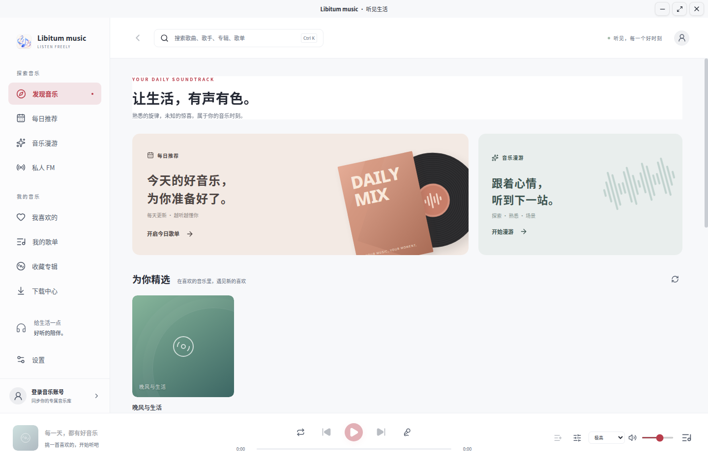
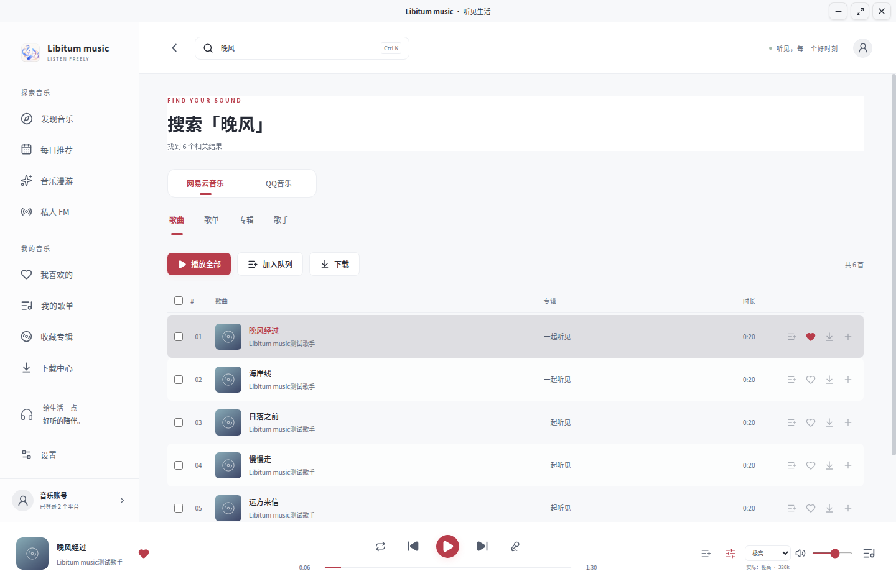
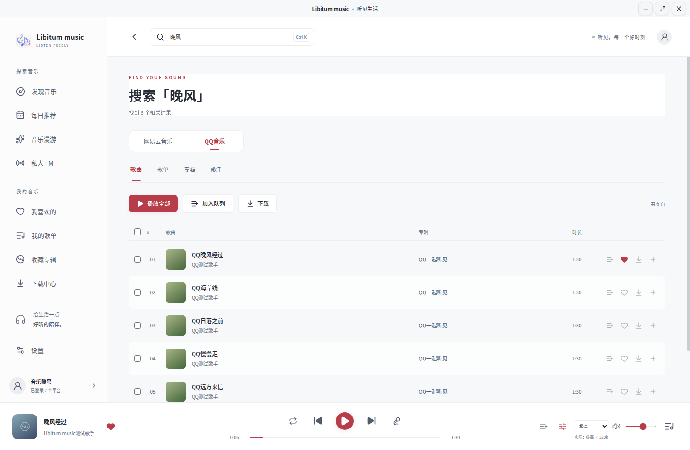
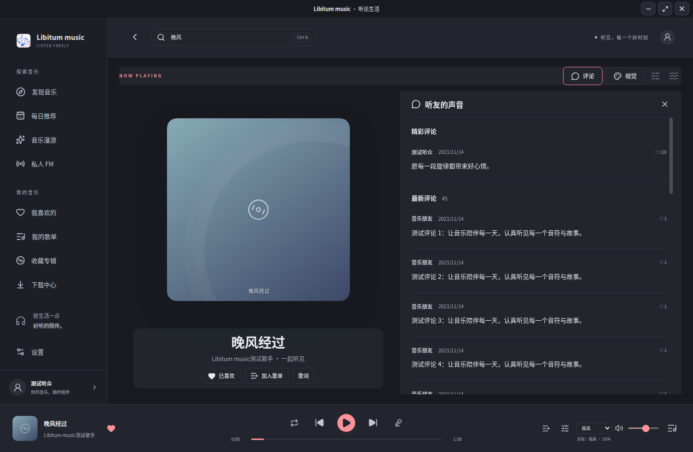
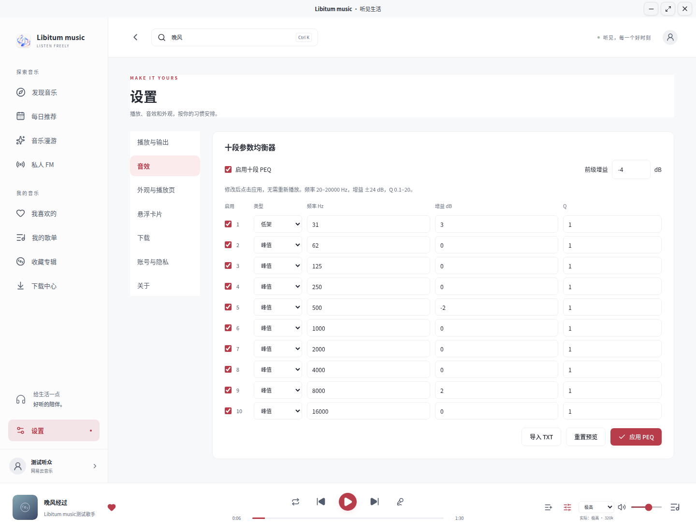

<div align="center">
  
  <h1>Libitum music</h1>
  <p><strong>让生活，有声有色。</strong></p>
  <p>一个简洁的 Linux 音乐空间。发现喜欢的旋律，也让每一次聆听更合心意。</p>
  <p>
    <a href="https://github.com/kuranshi/Libitum-Music/releases/tag/v0.3.0-rc.1"></a>
    <a href="#下载与安装"></a>
    <a href="#兼容范围"></a>
    <a href="LICENSE"></a>
  </p>
  <p>
    <a href="https://github.com/kuranshi/Libitum-Music/releases/tag/v0.3.0-rc.1"><strong>下载客户端</strong></a> ·
    <a href="#界面预览">界面预览</a> ·
    <a href="docs/user-guide.md">使用指南</a> ·
    <a href="#从源码运行">从源码运行</a> ·
    <a href="https://github.com/kuranshi/Libitum-Music/issues">反馈问题</a>
  </p>
</div>



Libitum music 是面向 Linux 的中文网易云音乐与 QQ 音乐桌面客户端，使用 **Electron · React · TypeScript · mpv**。从每日推荐到同步歌词，从十段 PEQ 到独立悬浮卡片，把发现、播放和管理音乐放在同一个桌面应用里，无需自行部署公共音乐代理。

**双平台同时登录：** 在“设置 → 账号与隐私”分别开启网易云音乐和 QQ 音乐，至少保留一个。两端可同时保存账号；都开启时，各音乐页面及搜索结果上方提供平台切换，并分别记忆选择。浏览切换不会打断音乐，播放队列可混合两端歌曲，下载按平台分开显示。关闭平台保留登录及下载记录。QQ 使用 **QQ 音乐 App** 扫码，详见[双平台使用说明](docs/user-guide.md#选择音乐平台)。

> **当前预发布版本为 `v0.3.0-rc.1`**，包含双端同时登录、分页面切换和 QQ 搜索／播放修复。真实账号权限、同步与硬件兼容的检查范围见[验证记录](VALIDATION.md)。

> 本页配图使用内置合成数据，展示本次发布的交互；不包含真实账号或个人资料。

## 为日常聆听准备

| | 可以做什么 |
| --- | --- |
| **发现下一首喜欢** | 每日推荐、精选歌单、排行榜与新专辑；私人 FM，以及熟悉、探索和场景模式的音乐漫游。 |
| **整理自己的音乐库** | 搜索歌曲、歌单、专辑与歌手；查看歌手热门歌曲和分页专辑，喜欢歌曲、收藏专辑与歌单、加入自己可编辑的歌单。 |
| **沉浸地听一首歌** | 大封面、逐行同步歌词、译文、点击歌词跳转；按需展开的独立评论面板，以及真实播放流频谱。 |
| **调整声音的细节** | mpv 播放、多档音质与输出设备切换；十段参数均衡器、前级、单段旁路及 APO / AutoEQ 预设导入。 |
| **布置自己的音乐空间** | 浅色、深色或跟随系统；图片与静音视频壁纸、双模糊、面板透明度、自定义配色和系统字体。 |
| **让音乐留在身边** | 独立悬浮卡片控制播放；下载任务并发、取消、重试，以及已下载文件的本地播放。 |

播放、音质和下载取决于账号权限及歌曲版权；不提供跨平台替代音源或权限绕过。

## 界面预览

### 两个平台，分别管理与浏览

在账号设置同时开启并登录两端，关闭开关仍保留登录。下图“测试听众”与“QQ测试听众”是程序内置合成账号。


同一个关键词可切换查看两端结果，各自保留分页；底部播放栏继续显示正在播放歌曲的来源。





### 专注聆听，也读懂歌词里的故事

点击底部封面进入播放详情。歌词随实际进度高亮，评论按需展开、独立滚动；切换深浅主题，让音乐空间适应你的桌面。



### 把声音调成喜欢的样子

十段 PEQ 支持峰值、低架和高架滤波，修改后应用，无需重新开始歌曲。音效只影响播放，不改动下载文件。



### 小小卡片，留住正在听的音乐

悬浮卡片现为 `280×64`，面积约为旧版的四分之一；主题、字体和壁纸跟随主界面，背景透明度可在“设置 → 悬浮卡片”独立调节。主窗口隐藏后仍可切歌、暂停、喜欢、调节音量与进度，或随时返回主窗口。

<p align="center">
  
</p>

<sub>以上均为本项目实际运行截图。所有画面均使用隔离的合成账号、歌单、曲目与评论；不包含真实账号、头像、个人歌单、下载或音乐文件。截图来源与复现方式见<a href="docs/screenshots.md">截图说明</a>。</sub>

## 下载与安装

已发布版本请在 [v0.3.0-rc.1 下载页](https://github.com/kuranshi/Libitum-Music/releases/tag/v0.3.0-rc.1)展开 **Assets**，选择安装包。`Source code.zip` 是源码。应用版本为 `0.3.0-rc.1`，Debian 控制版本为 `0.3.0~rc.1`。

| 格式 | 文件 | 适用场景 |
| --- | --- | --- |
| **DEB · 推荐** | `libitum-music-0.3.0-rc.1-amd64.deb` | Ubuntu 22.04 / 24.04 x86_64，由 apt 安装系统依赖。 |
| **AppImage** | `libitum-music-0.3.0-rc.1-x86_64.AppImage` | 其他现代 glibc Linux 桌面可尝试；需自行安装外部组件。 |

### Ubuntu：安装 DEB

在安装包所在目录执行，然后从应用菜单打开 **Libitum music**，或运行 `cloud-music-player`：

```bash
sudo apt update
sudo apt install ./libitum-music-0.3.0-rc.1-amd64.deb
cloud-music-player
```

升级前通过“退出应用”完全退出客户端，再运行上述安装命令。同版本覆盖安装可添加 `--reinstall`。内部包名仍为 `cloud-music-player`，升级保留本机设置、队列和下载。

<details>
<summary><strong>AppImage 安装与文件校验</strong></summary>

Ubuntu 24.04 的外部组件与启动方式：

```bash
sudo apt update
sudo apt install mpv ffmpeg pulseaudio-utils libsecret-1-0 libfuse2t64
chmod +x ./libitum-music-0.3.0-rc.1-x86_64.AppImage
./libitum-music-0.3.0-rc.1-x86_64.AppImage
```

Ubuntu 22.04 将 `libfuse2t64` 替换为 `libfuse2`，无需卸载 FUSE 3。其他发行版的包名与桌面配置见[使用指南](docs/user-guide.md#appimage)。Ubuntu 遇到 FUSE 或沙箱启动问题时优先使用 DEB。

将 Release 中的 `SHA256SUMS` 与安装包放在同一目录，核对文件：

```bash
sha256sum -c SHA256SUMS --ignore-missing
```

</details>

## 兼容范围

| 系统 | 安装包 | 已有验证范围 |
| --- | --- | --- |
| Ubuntu 24.04 x86_64 | DEB / AppImage | 已有实机 Wayland / X11、播放与隔离音频检查记录。 |
| Ubuntu 22.04 x86_64 | 同一个 DEB | 已有容器安装、启动、mpv 0.34.1、PEQ 与视频编码检查；实际桌面待验收。 |
| 其他现代 glibc Linux 桌面 | AppImage | 沿用现有兼容方式，未逐一验证。 |

当前只交付 **x86_64**，ARM64、32 位、Alpine / musl 和 NixOS 不在支持范围内。原生 Wayland 与 X11 均保留，悬浮卡片置顶受桌面协议支持限制。

播放需要 **mpv**；视频壁纸需要 **FFmpeg**；频谱需要 **PulseAudio 或 PipeWire 的 PulseAudio 兼容服务**及 `pulseaudio-utils`，原生 PipeWire 输出还需要 `pw-dump`。密钥环与实际硬件输出的验证边界见 [VALIDATION.md](VALIDATION.md)。

## 从源码运行

准备 **Node.js 24**、npm，以及系统组件 `mpv`、`ffmpeg` 和 `pulseaudio-utils`：

```bash
git clone --branch main https://github.com/kuranshi/Libitum-Music.git
cd Libitum-Music
npm ci
npm run dev
```

常用开发命令：

```bash
npm run build       # 类型检查与生产构建
npm test            # 单元测试
npm run test:e2e    # Electron 流程检查
npm run package     # 生成 AppImage 与 DEB，输出到 release/
```

当前源码构建的文件名为 `libitum-music-0.3.0-rc.1-amd64.deb` 和 `libitum-music-0.3.0-rc.1-x86_64.AppImage`，安装时使用实际文件名。

更多集成检查、Ubuntu 22.04 兼容检查和发布审计见[开发指南](docs/development.md)。

## 本机数据与隐私

应用状态保存在 `~/.config/cloud-music-player/`，下载默认位于系统音乐目录下的“Libitum music 下载”。登录会话仅在有效系统密钥环下加密持久保存，密钥环不可用时只保留本次会话。

频谱只监听本应用的 mpv 播放流，不录制麦克风、不采集整机混音、不保存 PCM。壁纸配色分析在本机内存中完成。会话、历史、下载、私人壁纸与 PEQ 均不作为项目文档或安装包资源上传。

## 文档与反馈

| 文档 | 内容 |
| --- | --- |
| [使用指南](docs/user-guide.md) | 登录、收藏、歌词、PEQ、频谱、外观、悬浮卡片、安装排错与卸载。 |
| [开发指南](docs/development.md) | 环境准备、源码结构、测试、打包与发布检查。 |
| [截图说明](docs/screenshots.md) | 截图数据来源、拍摄环境与复现命令。 |
| [验证记录](VALIDATION.md) | 已执行的检查、历史结果与待验收项目。 |
| [更新日志](CHANGELOG.md) | 各版本的功能变化与修复。 |
| [第三方说明](THIRD_PARTY_NOTICES.md) | 依赖组件与许可证。 |

遇到问题可提交 [Issue](https://github.com/kuranshi/Libitum-Music/issues)，附上应用版本、发行版、Wayland / X11、复现步骤和错误提示。请勿上传 Cookie、密码、令牌或个人账号数据。

## 许可证

源码采用 [MIT 许可证](LICENSE)。mpv、FFmpeg、PulseAudio 等系统组件遵循各自许可证，详见[第三方说明](THIRD_PARTY_NOTICES.md)。

<p align="center"><sub>好好生活，慢慢听歌。</sub></p>
