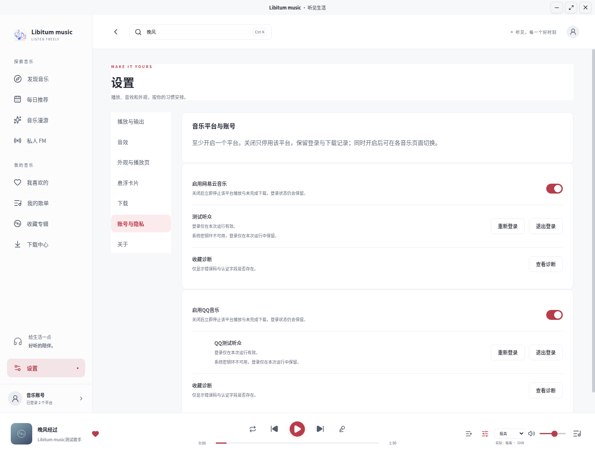
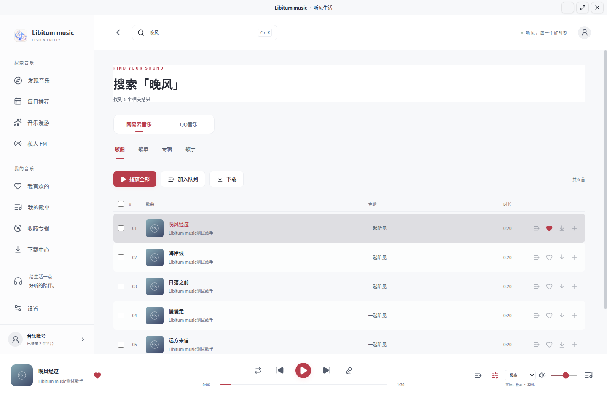
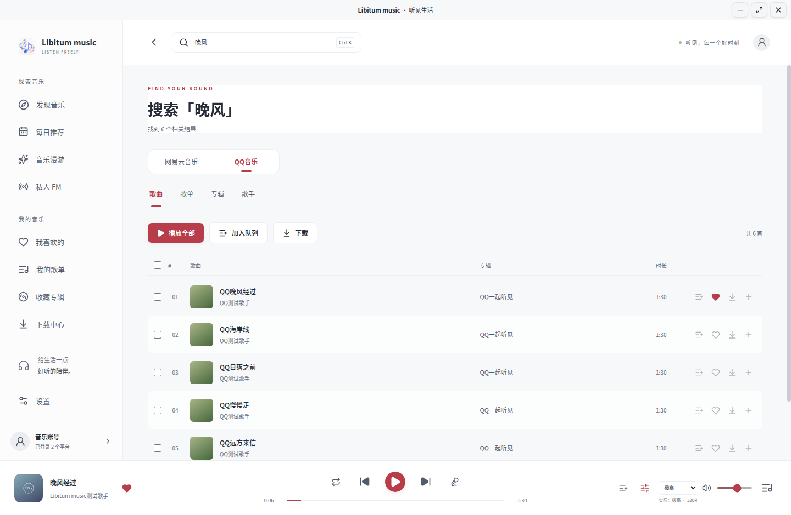

# 使用指南

[返回 README](../README.md) · [开发与构建](development.md) · [验证记录](../VALIDATION.md)

Libitum music 是面向 Linux 的中文网易云音乐与 QQ 音乐桌面客户端。在线内容、音质及下载权限由对应平台和账号权限决定，不提供跨平台替代音源。

## 选择音乐平台

首次使用默认只开启网易云音乐；从旧版升级会沿用此前的平台。在“设置 → 账号与隐私”可看到网易云音乐和 QQ 音乐两张卡片：

- 每个平台都有独立启用开关，至少保留一个开启。关闭开关保留登录状态，重新开启后可继续使用；跨重启保存仍需系统密钥环可用。
- 点击对应卡片的“登录”或“重新登录”。网易云使用网易云音乐 App 扫码，或导入本人的网页登录 Cookie；QQ 使用 QQ 音乐 App 扫码确认，普通 QQ 网页 Cookie 不作为完整音乐会话导入。
- 每个平台支持一个账号，两端可以同时登录。取消登录、退出账号或登录失效只影响对应平台。



### 单端与双端浏览

仅开启一个平台时，沿用单端页面，不显示额外的平台选择器。两端都开启时，发现音乐、每日推荐、音乐漫游、私人 FM、我喜欢、我的歌单、收藏专辑、下载中心和搜索结果上方会出现“网易云音乐／QQ音乐”切换按钮。

各页面独立记忆选择并在重启后保留；例如发现音乐选 QQ，我喜欢仍可使用网易云。临时关闭一个平台时，页面使用仍开启的平台，不覆盖原来的选择。搜索切换使用相同关键词与结果类型，两端的结果、分页、加载和错误状态分别管理。需要账号的内容会提示登录当前页面所属的平台。

歌单、专辑与歌手详情固定所属平台并显示来源；不会用另一端相同 ID 的内容替换。双端模式的侧边栏账号入口用于管理两个账号。





配图只使用项目内置合成账号与曲目，拍摄方法见[截图说明](screenshots.md)。

### 播放队列与下载

浏览页面或切换平台不会打断正在播放的歌曲。普通点击播放会替换队列；“加入队列”可把两端歌曲排在一起，逐首使用各自账号播放。歌词、评论、喜欢、加入歌单及悬浮卡片操作跟随歌曲来源，与当前浏览的平台无关。

两端下载共用最多 2 个并发任务；下载中心的平台按钮仅过滤显示，切换不会中断另一端下载。记录继续按平台和账号隔离，同平台更换账号后不会看到原账号的任务。

关闭平台时立即停止该端播放，并移除队列中该端歌曲；保留另一端歌曲但不自动开始。该端未完成下载变为“已中断”，已下载文件和记录保留；重新开启并登录原账号后可手动重试。另一端当前播放与下载继续。明确退出某端账号也只停止该端任务，保留其已下载文件和按账号隔离的记录。

| 功能 | 网易云音乐 | QQ 音乐 |
| --- | --- | --- |
| 搜索、歌曲／歌单／专辑／歌手详情、歌词、评论 | 沿用原接口 | 使用 QQ 对应接口，继续复用相同页面 |
| 喜欢、收藏、本人歌单、下载 | 以账号权限为准 | 以 QQ 账号权限为准，操作后确认状态 |
| 每日推荐、私人 FM、随心听／熟悉／探索 | 沿用原推荐流 | 使用 QQ 每日推荐、猜你喜欢与刷歌推荐 |
| 场景漫游、“不感兴趣”、听歌时长同步 | 沿用原接口 | 当前接口不支持，相关操作会明确提示 |
| 音质 | 标准、较高、极高、无损、Hi-Res | 标准 128k、极高 320k、无损；“较高”对应 QQ 320k 并显示实际极高音质，独立 Hi-Res 暂不支持 |

QQ 不支持的功能不会改用网易云内容。播放或下载始终受对应平台的会员、购买与版权权限限制；下载所选音质与返回音质不符时需要重新选择，不把试听保存为完整歌曲。QQ 收藏结果未知时，先点击“状态待确认”刷新核对，再决定是否重新操作。

## 安装与升级

当前 `main` 源码版本为 `0.3.0-rc.1`，包含本页双平台功能，需要自行构建。已发布版本为 [`v0.2.0-rc.3`](https://github.com/kuranshi/Libitum-Music/releases/tag/v0.2.0-rc.3)，不含双平台功能。在发布页的 **Assets** 中下载安装包；`Source code.zip` 是源码。这是供体验和反馈的预发布版本，真实账号权限、同步及硬件兼容的验证范围见[验证记录](../VALIDATION.md)。

下方安装命令使用已发布包的文件名；自行构建当前源码后，应改用 `libitum-music-0.3.0-rc.1-amd64.deb` 或 `libitum-music-0.3.0-rc.1-x86_64.AppImage`。

### Ubuntu：推荐 .deb

在安装包所在文件夹运行：

```bash
sudo apt update
sudo apt install ./libitum-music-0.2.0-amd64.deb
cloud-music-player
```

安装器会处理 mpv、FFmpeg、PulseAudio 工具和桌面运行库依赖。安装后也可从应用菜单打开 **Libitum music**。文件在其他位置时，请使用实际完整路径，并为含空格的路径加引号。

升级前通过“退出应用”完全退出，再运行上述安装命令。内部 Debian 包名为 `cloud-music-player`，升级会保留本机账号、设置、队列与下载。

### AppImage

下载 `libitum-music-0.2.0-x86_64.AppImage`。Ubuntu 24.04 可运行：

```bash
sudo apt update
sudo apt install mpv ffmpeg pulseaudio-utils libsecret-1-0 libfuse2t64
chmod +x ./libitum-music-0.2.0-x86_64.AppImage
./libitum-music-0.2.0-x86_64.AppImage
```

Ubuntu 22.04 请把 `libfuse2t64` 替换为 `libfuse2`。FUSE 2 与 FUSE 3 可以共存，无需卸载桌面正在使用的 FUSE 3。参见 [AppImage 的 FUSE 说明](https://docs.appimage.org/user-guide/troubleshooting/fuse.html)。

AppImage 依赖系统安装的 mpv、FFmpeg、PulseAudio 工具及 libsecret。其他现代 glibc 桌面可通过各自的软件包管理器安装，包名以发行版为准。视频壁纸需要 FFmpeg 的 `libx264` 编码器。

FUSE、用户命名空间及 Chromium 沙箱受系统配置影响；Ubuntu 遇到相关启动错误时，优先使用 `.deb`。不要把关闭浏览器沙箱作为日常启动方式。

### 校验下载

把发布附件中的 `SHA256SUMS` 与安装包放在同一目录，再运行：

```bash
sha256sum -c SHA256SUMS --ignore-missing
```

### 兼容范围

| 系统 | 安装方式 | 已记录的验证边界 |
| --- | --- | --- |
| Ubuntu 24.04 x86_64 | `.deb` 或 AppImage | 项目已记录 Wayland / X11、播放链路及隔离音频检查；具体范围见验证记录 |
| Ubuntu 22.04 x86_64 | 与 24.04 相同的 `.deb` | 隔离安装、正式启动、mpv 0.34.1、PEQ 和视频编码有通过记录；实际桌面仍待验收 |
| 其他现代 glibc 桌面 | 适用时使用 `.deb`，或现有 AppImage | 未提供逐发行版的完整验证承诺 |

当前只交付 **x86_64**。ARM64、32 位、Alpine / musl、NixOS 及过旧系统不在当前交付范围。容器检查不证明硬件输出、设备拔插、密钥环或窗口管理器行为均正常。

## 找歌、播放与收藏

首页提供每日推荐、推荐歌单、排行榜和新专辑；私人 FM 与音乐漫游可连续推荐，漫游支持熟悉、探索及场景等模式。需要账号的功能会提示登录。

搜索支持歌曲、歌手、专辑和歌单。详情页可播放全部、加入队列、喜欢或下载。播放栏及播放详情里的歌手名可打开歌手主页，继续查看热门歌曲与分页专辑。

“加入歌单”可把当前歌曲或歌曲行加入自己创建的可编辑歌单；“我喜欢的音乐”使用爱心按钮。专辑和歌单收藏会读取当前状态、提交一次操作并回查结果。明确拒绝时保留原状态；网络中断且结果未知时显示“状态待确认”，点击该按钮只刷新状态。

标准、较高、极高、无损和 Hi-Res 为可选音质。界面会区分所选音质与实际音质，并显示试听状态；可播放和下载的内容仍取决于账号权限及版权。

### 窗口与音质显示（源码／本地预览）

顶部标题栏与当前壁纸连成一体；没有壁纸时，跟随主题或自定义背景色。拖动标题区域可移动窗口，右侧按钮用于最小化、最大化／还原和关闭。窗口大小也可通过边缘调整，具体手势由桌面环境决定。

在“设置 → 外观与播放页”或播放页“视觉”调整“面板模糊”，标题栏会即时预览。三个窗口按钮使用独立的高对比配色，方便在不同背景下操作。

右下角显示所选音质、实际音质和码率，返回音质较低时标注“降级”，悬停可查看说明。普通音质变化不再额外显示横条；播放失败、设备断开和试听限制仍会提醒。

开启悬浮卡片后，关闭主窗口只隐藏界面，音乐与下载继续；未开启卡片时，关闭主窗口会正常退出应用。

### 播放详情、歌词与评论

点击底部封面或歌名打开播放详情。歌词根据实际播放进度高亮、居中，支持译文与点击跳转。手动浏览后暂停跟随，停止操作 5 秒后恢复；也可点击“回到当前歌词”。拖动播放进度或点击歌词会立即恢复跟随。无时间轴时显示静态全文，加载失败可重试。

展开歌词后，左侧允许有限下拉以增加显示空间；自动跟随只移动歌词框。歌词与评论分别滚动，不带动外层页面。

评论默认收起，点击播放详情右上角“评论”后从右侧展开，与封面区域各占半屏；可用关闭按钮或 `Esc` 收起。在“设置 → 外观与播放页”关闭“启用歌曲评论”后，不再请求评论。

### 输出设备与进度

在“设置 → 播放与输出”选择设备。常用列表显示优先后端，其余路径可通过“显示高级音频后端”查看，不同 HDMI 输出仍分别列出。指定设备断开时暂停并提示重新选择；切换设备保留当前歌曲与进度。

主窗口和悬浮卡片的进度条均使用 mpv 实际时间。拖动取消、窗口失焦后恢复实时显示，状态通知停更时回查实际时间。

### 下载中心

下载支持并发、取消、重试及完成后的本地播放，目录与默认音质可在“设置 → 下载”中修改。下载保存服务端返回的真实格式，不把试听片段保存为完整歌曲；音质不匹配时需要重新选择。

## 十段 PEQ

点击播放栏的均衡器按钮，或进入“设置 → 音效”。十段滤波器支持峰值、低架、高架、单段旁路及前级。点击“应用 PEQ”生效，无需重新开始歌曲；关闭总开关并应用可旁路整个均衡器。PEQ 仅影响播放，不修改下载文件，需要 mpv 的 lavfi 音频滤镜。

可导入 APO／AutoEQ 文本或每行“频率、增益、Q”三列文本。以下为合成示例：

```text
Preamp: -4 dB
Filter 1: ON PK Fc 1000 Hz Gain -3 dB Q 1
Filter 2: ON LSC Fc 105 Hz Gain 2 dB Q 0.71
```

```text
1000 -3 1
105 2 0.71
```

导入会先预览，确认后应用。最多十段，不支持的类型或越界参数会报错。

| 参数 | 范围 |
| --- | --- |
| 频率 | 20–20000 Hz |
| 增益 | −24–24 dB |
| Q | 0.1–20 |
| 前级 | −30–12 dB |

超出当前歌曲采样率有效范围的频段会暂不应用并提示。

## 频谱与个性外观

### 实时频谱

在播放详情或“设置 → 外观与播放页”开启，可选单色、渐变及颜色。频谱仅监听本应用的 mpv 播放流，不录制麦克风、不采集整机混音、不保存 PCM。

需要运行中的 PulseAudio 或 PipeWire 的 PulseAudio 兼容服务及 `pulseaudio-utils`。原生 PipeWire 输出还需要 `pw-dump`，Ubuntu 对应 `pipewire-bin`。ALSA 直通或无法确认本应用播放流时，界面显示不可用原因，音乐仍可播放。

若工具齐全而旧候选构建仍提示无法监听，可更新安装包；也可在“播放与输出 → 显示高级音频后端”临时选择同一设备的 PulseAudio 路径，再开启频谱。

### 图片与视频壁纸

支持 JPEG、PNG、WebP、GIF、BMP、AVIF 及 MP4、WebM、MOV、MKV、AVI。图片上限 64 MB，视频上限 4 GB。视频通过 FFmpeg 转为不高于 1080p / 30fps 的静音 MP4；导入可取消，失败时保留原背景。

壁纸可用于仅播放详情或整个应用，全局壁纸会连续延伸到左侧导航。视频始终静音循环，页面隐藏时暂停；开启封面旋转后，封面随音乐暂停。壁纸沿用当前浅色、深色或系统主题。

在“设置 → 外观与播放页”或播放详情右上角“视觉”调整：

| 设置 | 作用 |
| --- | --- |
| 背景亮度、遮罩深度 | 控制壁纸明暗 |
| 壁纸模糊 | 0–40 px，只模糊壁纸 |
| 面板模糊 | 0–30 px，只影响面板背景 |
| 面板透明度 | 0% 为不透明，100% 为完全透明，默认 4% |

模糊和透明度滑杆拖动时预览，松开保存，保存失败恢复原值。面板透明度统一作用于设置、歌曲信息、歌词、评论、弹窗、视觉菜单和队列，文字保持清晰；系统原生文件选择器与下拉弹层沿用系统外观。

### 配色与字体

“自定义配色与字体”支持背景颜色、文字颜色和本机已安装字体，点击“应用外观”保存，“跟随主题”可清除自定义颜色。背景色在未使用壁纸时可见。手动字色覆盖设置、播放详情、歌词、评论与应用内菜单的普通文字，应用新字色会关闭自动配色。

“壁纸文字自动配色”默认关闭。开启后依据本机内存中的壁纸主色与明暗选择文字及强调色，不改变壁纸或遮罩；视频定时抽样，隐藏时停止。关闭后使用主题或自定义文字颜色。

背景仅受显式的亮度、遮罩和模糊控制。文字对比低于 4.5:1 时会提示，并提供“恢复主题字色”，不会自动改色或加深背景。

## 悬浮卡片

在“设置 → 悬浮卡片”开启，卡片为固定 `280×64`，面积约为旧版的 26%，提供封面、歌名、歌手、进度、上下首、播放／暂停、喜欢与音量控制。拖动歌曲信息区域可移动卡片。

卡片跟随主界面的主题、手动／自动配色、字体及当前启用的图片或视频壁纸（壁纸范围仅播放页时也会在卡片显示）。亮度、遮罩、模糊共用主界面设置。“卡片背景透明度”单独调节：0% 不透明、100% 完全透明，默认 4%；松开滑杆或键盘提交后应用并保存，失败恢复原值。它不改变主界面面板透明度，文字和按钮始终保持不透明；桌面合成器对透明窗口的支持可能不同。

开启后，关闭主窗口只隐藏主界面，音乐与下载继续。卡片的“返回主窗口”恢复界面；关闭卡片会停用卡片并恢复主窗口；电源按钮退出整个应用。

应用保留原生 Wayland。置顶和程序恢复窗口位置受桌面协议限制；X11 会保存并校验位置。如需使用 X11 窗口行为，可完全退出后手动启动：

```bash
cloud-music-player --ozone-platform=x11
```

应用不会自动切换窗口协议。

## 账号、诊断与本机数据

支持网易云音乐扫码／本人 Cookie 登录，以及 QQ 音乐 App 扫码登录。重新登录和网易云 Cookie 导入均在应用内完成；不要把 Cookie、密码或令牌发到聊天、Issues 或源代码中。

在“设置 → 账号与隐私 → 查看诊断”可查看本次运行的接口、错误码及认证字段是否存在，诊断不显示字段值。登录失效或 CSRF 字段缺失时可重新扫码；403 访问拒绝、频率限制和明确风控会分别提示。手机端出现的官方限制仍需按官方提示处理，客户端不能保证解除。

应用状态位于 `~/.config/cloud-music-player/`；下载默认放在系统音乐目录的“Libitum music 下载”中，实际目录以设置为准。有效系统密钥环解锁时，会话由 Electron safeStorage 加密保存；不将 `basic_text` 视为安全存储。缺少有效后端时，账号仅在本次运行中保留。

QQ 音乐继续使用同一安全存储流程。`qqmusic-device.json` 仅保存本安装的稳定设备种子，文件权限为 `0600`；它不保存原始账号 Cookie。旧版未标记平台的会话与下载记录按网易云音乐迁移。

退出账号会清除会话、队列和账号下载记录，已经下载的音频文件保留。壁纸、私人 PEQ、历史、队列和下载均为本机数据。仓库仅公开经审核的 `docs/images/` 项目展示截图；个人媒体、凭证、运行资料及测试截图仍不纳入 Git。

## 常见问题

| 情况 | 处理方式 |
| --- | --- |
| 安装提示找不到 `.deb` | 确认实际文件名与当前目录，或使用完整路径 |
| 更新后仍是旧候选构建 | 完全退出应用，确认下载的是当前测试版，再运行上述 apt 安装命令并重新打开 |
| AppImage 提示缺少 FUSE | 按 Ubuntu 版本安装 FUSE 2 库，或改用 `.deb` |
| 音乐无法播放 | 确认已安装 mpv，检查输出设备及歌曲权限；最低基线为 mpv 0.34.1 |
| 频谱不可用 | 检查 `pactl`、`parec`、音频兼容服务及输出后端；原生 PipeWire 还需 `pw-dump` |
| 重启后需要重新登录 | 检查桌面密钥环是否可用且已解锁 |
| 收藏显示“状态待确认” | 点击刷新核对结果，避免重复提交；必要时查看账号诊断 |
| Wayland 下卡片无法置顶 | 窗口行为由桌面协议决定；需要时手动使用 X11 |

## 卸载

```bash
sudo apt remove cloud-music-player
```

AppImage 用户退出后删除对应文件即可。卸载不会自动删除用户目录中的账号数据、壁纸、PEQ 或音乐下载。
